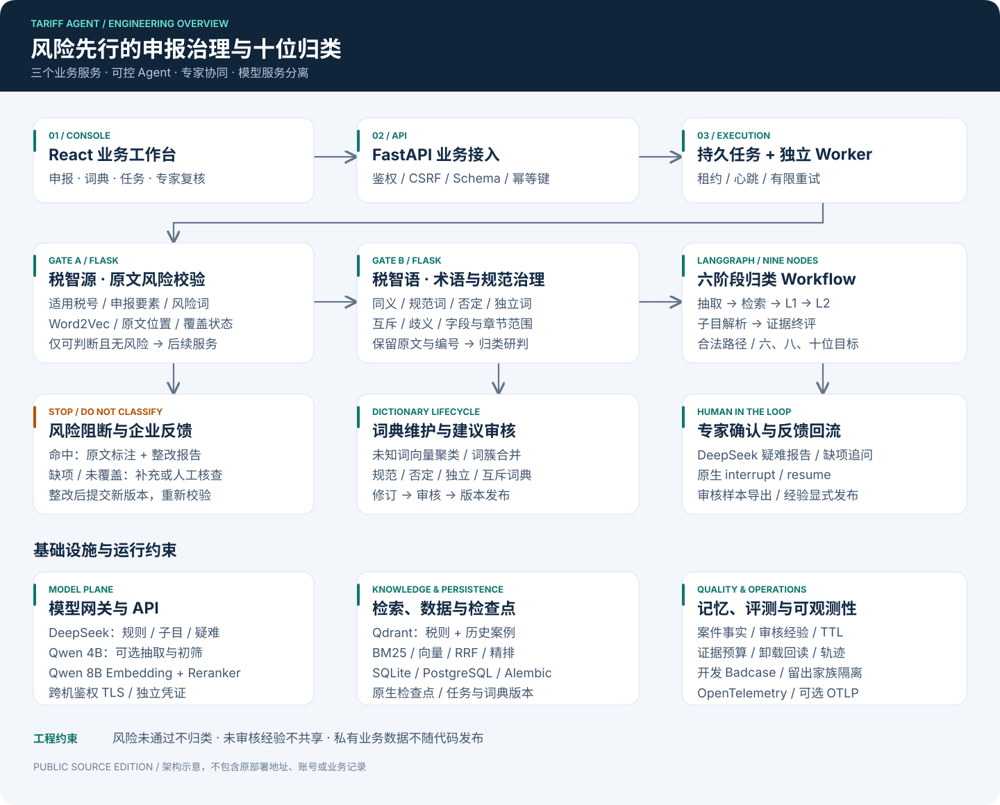
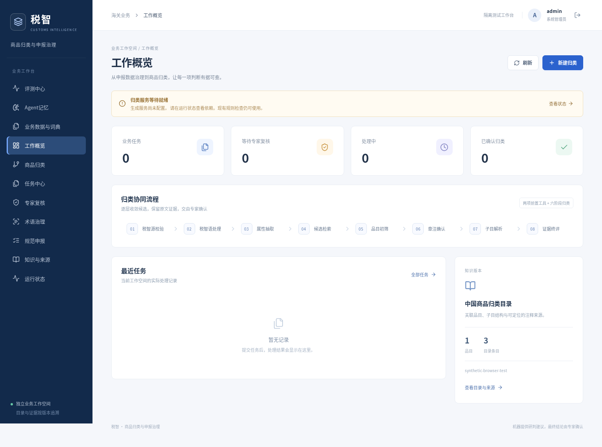
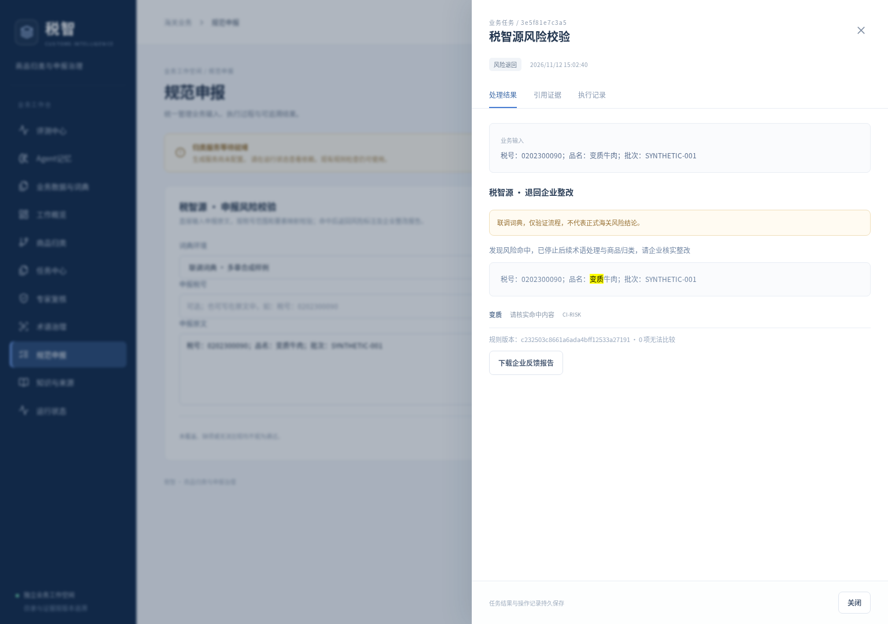
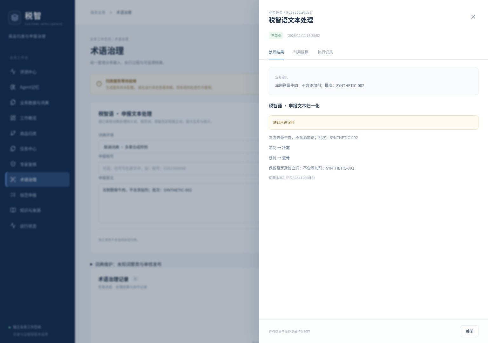
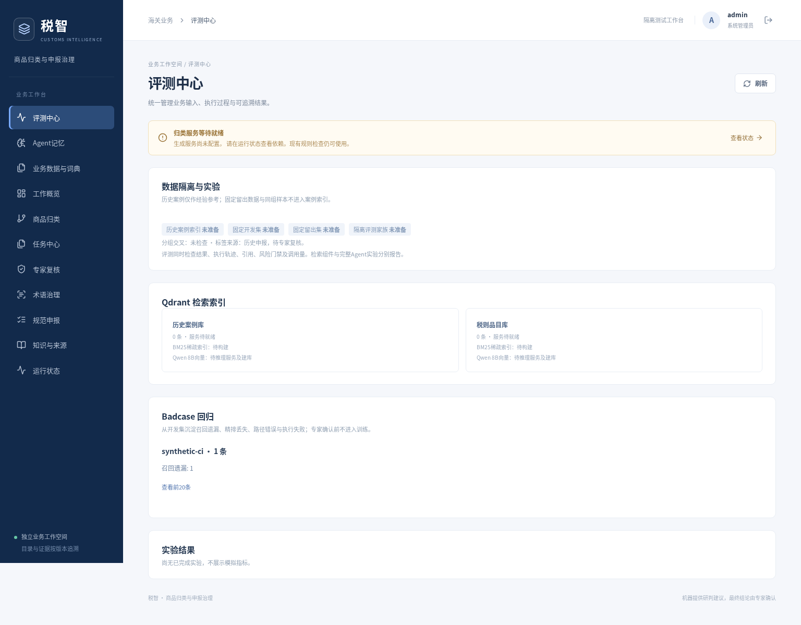
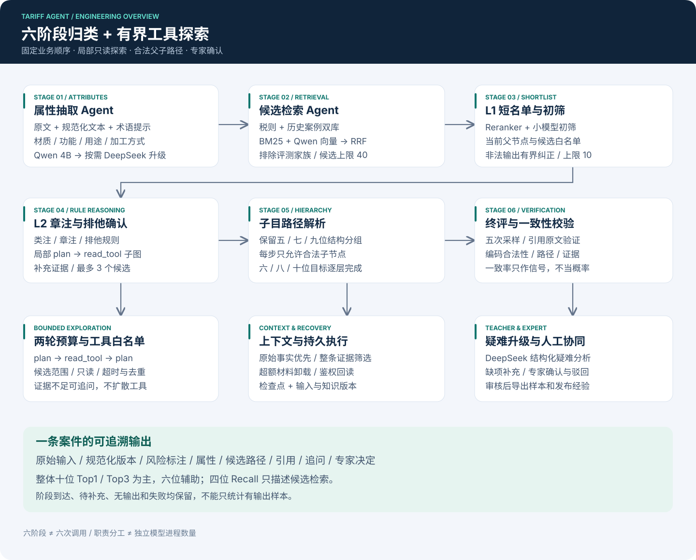
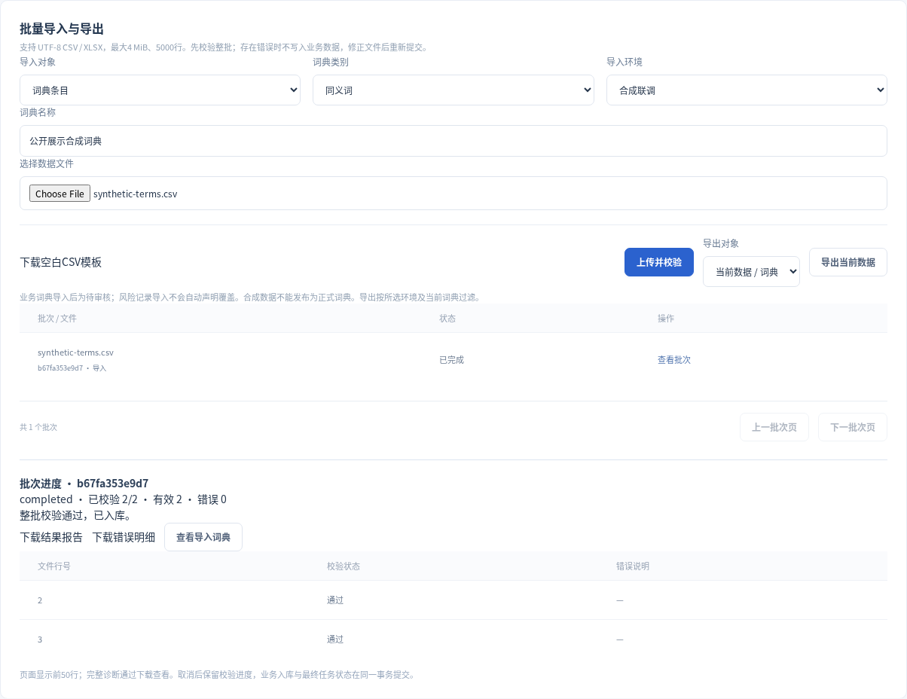

<div align="center">

# Tariff Agent · 海关商品归类与申报治理

**风险先行 · 术语治理 · 十位归类 · 专家协同 · 可恢复执行**

[](https://github.com/Kevin-Lee77/tariff-agent/actions/workflows/ci.yml)


面向申报文本风险核查、领域术语处理与层级商品归类的 Python 全栈工程。

[系统设计](docs/architecture.md) · [快速运行](#快速运行) · [接口与集成](docs/api.md) · [部署说明](docs/deployment.md) · [评测方法](docs/evaluation.md)

</div>



## 为什么做这个项目

企业申报原文常混有别名、非规范词、否定表达与缺失属性。商品归类还需要遵守“章—目—子目”层级、类注/章注及排他规则。让一个模型自由搜索后输出税号，难以追踪风险检查、路径、证据和故障恢复。

本项目将业务拆成三个可独立调用、也可组合执行的服务：

- **税智源：** 先检查申报原文，按税号范围和申报要素定位风险词，结合精确规则与 Word2Vec 相似度生成风险标注。命中风险即停止归类；缺项、未覆盖和无法比较分别返回待补充或待核状态。
- **税智语：** 风险通过后执行同义词归一、规范词检查、否定作用域和独立词保护、互斥/歧义提示及未知词向量聚类建议。批次、订单、SKU、任务号与税号等字段不参与普通术语替换。
- **归类 Agent：** 用 LangGraph 组织六阶段研判，结合税则与历史案例检索、层级路径约束、疑难分析和专家复核，默认面向十位编码，也支持六位、八位目标。

**业务顺序：** 原始申报 → 风险校验 → 术语治理 → 归类研判 → 专家审核 → 反馈样本与审核经验。

## 界面预览

截图来自隔离环境中的**程序生成合成数据**，不展示客户材料、真实报关单、私有词典或测试集。



<details>
<summary>查看风险核查、术语治理与评测页面</summary>







</details>

## 核心实现

### 受控 Workflow 与局部工具探索

主图包含 **2 个前置治理节点 + 6 个归类阶段 + 1 个疑难教师节点**。节点对应可追踪阶段，不代表独立模型进程，六阶段也不等于六次模型请求。



1. **属性抽取：** 从原文和规范化文本提取材质、用途、功能、加工方式等属性，以 Pydantic/JSON Schema 约束输出；缺失信息不凭空补全。
2. **候选检索：** BM25 与 Qwen 向量召回经 RRF 融合；Qdrant 保存税则与历史案例两类索引，案例召回排除评测家族。
3. **L1 短名单：** Reranker 精排后交给小模型初筛；异常或冲突按配置升级 DeepSeek。
4. **L2 规则确认：** 结合类注、章注和排他规则；局部 `plan → read_tool` 子图最多两轮，只允许白名单只读工具。
5. **子目解析：** 从已选父节点逐层解析至六/八/十位，保留五/七/九位结构分组，禁止跳层和目录外编码。
6. **终评校验：** 检查路径、证据原文与多次采样一致性；疑难情况形成 DeepSeek 报告，进入补充信息或专家复核。

检索初期的四位品目是**候选入口**；十位结果单独评测。引用文本校验与采样一致率不等同于法律适用正确率或校准置信概率。

### 三个服务，两种接入方式

FastAPI 提供业务任务、专家审核、术语维护和工作台 API。税智源、税智语各自运行 Flask/WSGI 服务，可由业务系统单独调用，也可作为归类工具接入 Workflow。FastMCP 提供独立工具接入入口，复用业务校验逻辑。

### 状态、记忆与恢复

- 独立 Worker、持久任务、幂等键、租约、心跳及有限重试；检查点写入校验任务所有权。
- 使用 LangGraph SQLite/PostgreSQL 原生检查点，专家确认采用独立 `interrupt/resume` 流程。
- 区分案件事实与专家经验记忆；共享经验需显式审核发布，并受版本、TTL、撤销和候选范围约束。
- 结构化上下文保留原始事实，按预算筛选整条证据并卸载可回读材料。
- OpenTelemetry 串联 API、Worker、Flask 和模型调用，支持本地存储和可选 OTLP。Langfuse 配置可生成，实例需自行启动。

### 数据、权限与质量

- SQLAlchemy 支持 SQLite/PostgreSQL，Alembic 管理迁移；业务词典具有修订、审核与版本状态。
- Argon2 密码、服务端会话、角色权限、CSRF 和审计记录。
- 开发集 Badcase 分型、冻结留出集、同组案例隔离、指纹及前后版本对照。
- 只有专家确认样本才能导出反馈；LoRA 训练与权重发布是独立步骤，不将模型猜测自动当标签。

### 词典与批量业务管理

已补充CSV/XLSX异步导入、逐行校验及错误报告、批次进度/取消/重试和数据导出；词典支持主从词切换、拆组、合组、移动、改名、确认/撤销确认，以及历史回退草稿和撤销发布。跨要素互斥与人工配置评分保留命中依据。文件只要有一行不合格，整批不写业务库；最终入库与任务完成在同一租约保护事务提交。操作及边界见 [业务管理说明](docs/business-workflows.md)。

<details>
<summary>查看合成文件导入、逐行进度与报告下载</summary>



</details>

## 技术栈

- **后端与编排：** Python 3.11、FastAPI、Flask/Gunicorn、Pydantic、LangGraph、FastMCP。
- **模型与检索：** DeepSeek API、可选 Qwen3-4B、Qwen3-Embedding-8B、Qwen3-Reranker-0.6B、BM25/RRF、Qdrant、Word2Vec。
- **数据与运行：** SQLAlchemy、SQLite/PostgreSQL、Alembic、Supervisor、Docker Compose、OpenTelemetry。
- **前端与验证：** React 19、Vite、Playwright、pytest、Ruff、GitHub Actions。

生成、向量和精排均通过配置接入。GPU 网关可与业务服务分机部署。

## 快速运行

### 1. 安装环境

建议 Linux、Python 3.11、Node.js 22，在项目根目录执行：

```bash
git clone https://github.com/Kevin-Lee77/tariff-agent.git
cd tariff-agent
python3.11 -m venv .venv
source .venv/bin/activate
pip install -r requirements.prod.lock
pip install --no-deps -e .
npm --prefix frontend ci
npm --prefix frontend run build
```

### 2. 验证工程和界面

```bash
pip install pytest ruff pgserver==0.1.4
ruff check src/tariff_agent tests scripts migrations
pytest -q

# 隔离界面模式：随机账号、合成数据，不加载 .env，不调用付费模型
python scripts/serve_e2e.py
```

访问 `http://127.0.0.1:18001`。临时账号保存在本机 `.runtime/e2e/credentials.json`；重启会生成新账号。此模式只验证界面和流程，不提供正式归类结论。

浏览器自动测试会自行启动隔离服务，执行前停止上面的手动服务：

```bash
cd frontend
npx playwright install --with-deps chromium
E2E_FIXTURES=1 E2E_BASE_URL=http://127.0.0.1:18001 \
  E2E_CREDENTIAL_FILE=../.runtime/e2e/credentials.json npm run test:e2e
```

### 3. 配置业务运行

```bash
tariff init-config
# 编辑私有 .env：填写模型接口、密钥、数据库和授权数据路径
alembic upgrade head
tariff create-user admin --role admin
mkdir -p run logs
supervisord -c deploy/supervisord.conf
```

入口为 `http://127.0.0.1:18000`。正式运行需要自行提供授权税则、注释、词典与案例；模型和索引准备见 [部署说明](docs/deployment.md)。`/health/live` 检查进程，`/health/ready` 检查业务依赖；未就绪时保留明确状态。

## 代码导航

```text
src/tariff_agent/
  api.py / auth.py                  业务 API、会话和权限
  workflow.py / prompts.py          主图编排和模型契约
  declaration.py / governance.py    风险、术语和规范值算法
  flask_services.py                 独立治理服务
  governance_tools.py / mcp_server.py 工具适配及 MCP
  knowledge.py / retrieval.py / history.py
                                    层级目录、双库召回和证据
  durable.py / human_review.py      检查点与专家恢复
  agent_memory.py / runtime_context.py
                                    工作记忆、审核经验和版本
  context_engineering.py / agentic_retrieval.py
                                    上下文预算与局部工具探索
  assets.py / persistence.py        业务词典与数据库
  eval_runner.py / stage_metrics.py / badcases.py
                                    任务与轨迹评测、阶段指标
frontend/                           React 工作台
scripts/                            导入、模型准备、评测和验证
migrations/                         Alembic 数据库迁移
deploy/                             运行与观测配置
tests/                              隔离生成样本的工程测试
docs/                               设计、接口、部署和评测文档
```

## 评测与结果边界

本次发布副本通过 **147 项后端测试、15 项浏览器测试**，Ruff 与前端生产构建通过。测试使用隔离生成的数据，不需要业务词典、GPU或付费模型；后续状态以 GitHub Actions 为准。

归类主指标为**十位 Top1/Top3 标签一致率**，六/八位用于分层定位；四位 Recall@K 分析候选检索，不替代归类成绩。治理分别评估风险决策、原文跨度、规范化全文、否定保护和编号保真。

真实业务集、开发/留出集、报关单、私有词典、逐条预测和运行报告不随代码发布。没有授权数据时可运行合成工程测试，不能据此复现私有业务集成绩。详见 [评测方法](docs/evaluation.md)。

## 数据与发布范围

保留算法、编排、前后端、迁移和通用部署；不包含密码、API Key、内网拓扑、个人目录、客户材料、真实测试样本、数据库或模型权重。截图只使用合成数据。发布前执行：

```bash
python scripts/check_public_release.py
```

数据约定见 [数据契约](docs/data-contracts.md)，依赖与参考设计见 [来源说明](NOTICE.md)。
