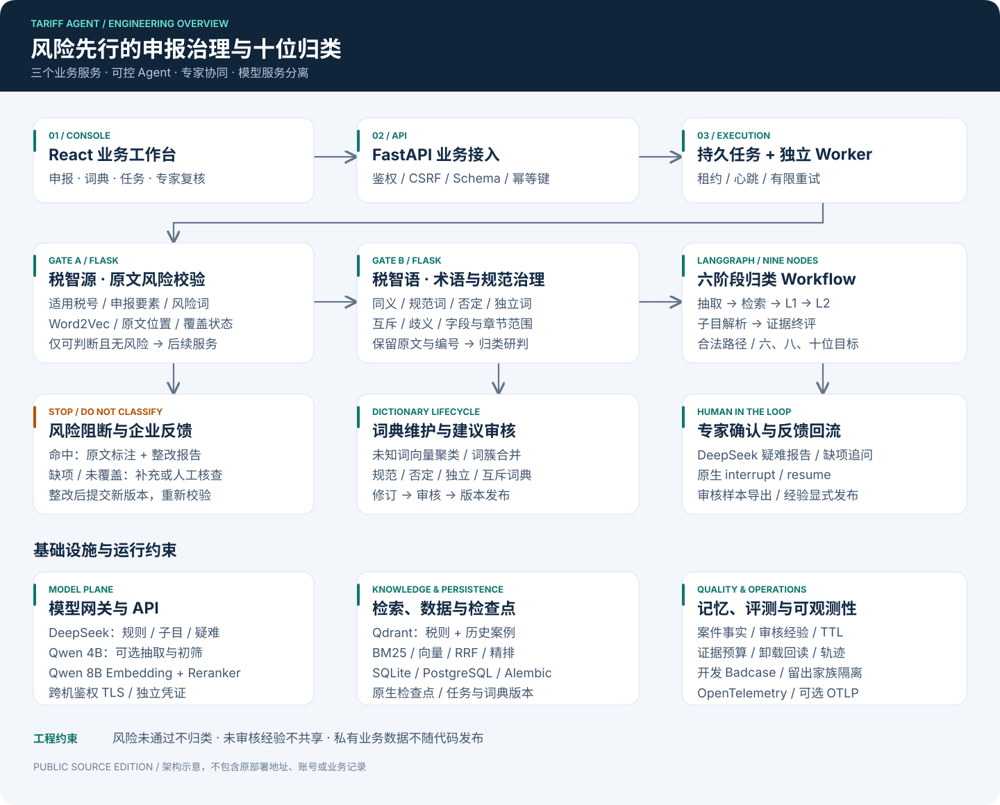
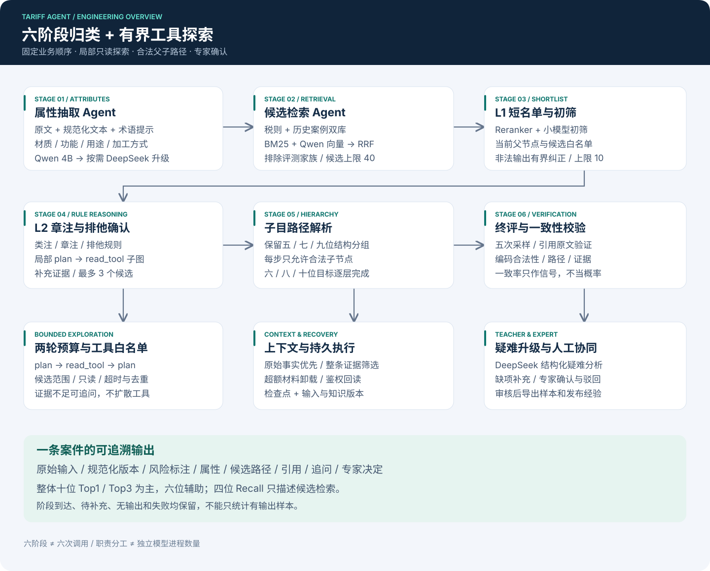

# 系统设计

## 风险先行的三个服务

请求保留原文、可选申报税号、结构化要素及目标位数。既支持一段自由申报文本，也支持已有要素字段；先解析原文匹配税号和要素，不能将税智源理解为“只能填写要素”。

税智源在原文上检查税号范围、要素、风险词和相似度。只有覆盖可判断且未命中风险才进入税智语；风险命中生成原文位置、来源和反馈，缺项/未覆盖进入待补充或人工核查。

税智语保存原文并生成规范化版本。词典有章节和字段范围，否定与独立词有保护区间，互斥与歧义需复核。批次、订单、SKU、任务号和税号不参与普通替换。未知词聚类属于词典维护，只生成建议，审核后才可发布。

## Agent 图

九个主节点为 `risk_precheck → normalize → attributes → retrieve → l1 → l2 → subheading → verify → teacher`；教师节点按条件触发。抽取、检索、规则、校验和专家协同是职责划分，六阶段是流水线定义，不对应固定数量的独立模型。

小模型负责抽取和初筛，DeepSeek 承担复杂研判及升级。固定业务顺序，L2 内允许最多两轮 `plan/read_tool`，且仅限白名单只读工具。四位候选随后沿目录树到六/八/十位，五/七/九位结构分组也保留。目录外编码、非法父子关系和引用不匹配由程序拒绝。

## 执行与持久化

业务文件批次同样复用持久任务与Worker，附件和逐行结果分别落表。先完成有界解析和全行校验，最终导入与任务完成在一个租约保护事务提交；取消和故障重试有独立验证。词典修改保留不可变修订、快照指纹和发布谱系，详见[业务管理](business-workflows.md)。

FastAPI 写入持久任务，独立 Worker 用租约、心跳和幂等键控制执行。LangGraph 原生检查点保存状态，恢复时核对输入与知识版本。SQLAlchemy 支持 SQLite/PostgreSQL，Alembic 管理迁移。Compose 方案将所有业务服务连接同一 PostgreSQL。

两个 Flask/Gunicorn 服务既可独立对接，也由 Agent 工具适配器调用。FastMCP 暴露领域工具；工具接入遵守同一 Schema、候选范围和来源规则。

## 检索与上下文

Qdrant 存放税则和历史案例两类索引。BM25 与 Qwen 稠密召回经 RRF 融合，Reranker 调整顺序；案例仅作经验参考，不能覆盖正式注释。评测样本及同组近重复项从索引排除。

上下文优先保留原文、属性和来源版本，整条证据去重及预算筛选，超额材料卸载后鉴权回读。代理 token 计数与实际账单不同，不能直接当费用节省。

## 记忆、人工与观测

案件工作记忆保存本案事实；共享专家经验必须审核发布，带版本、TTL、范围和撤销状态。模型输出不自动成为共享记忆或训练标签。

支持补充信息、审核确认/驳回及原生 `interrupt/resume`。确认样本可导出，LoRA 训练与权重发布需独立评测，仓库没有自动训练发布流水线。

OpenTelemetry 串联任务、模型与工具，默认本地存储，可选 OTLP。Prometheus 提供运行指标。Langfuse 配置生成、启动实例与验收是不同步骤；Trace 不自动外发申报原文或完整 Prompt。
